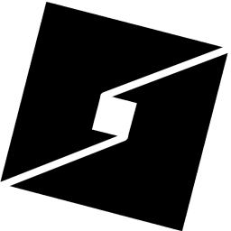

# Salt

<picture>
  <source media="(prefers-color-scheme: dark)" srcset="data/icons/white/256x256/salt.png">
  
</picture>

Salt runs **Roblox Studio on Linux**. It is a Rust rewrite of
[Vinegar](https://github.com/vinegarhq/vinegar) by VinegarHQ, focused on speed
and stability, with a built-in bridge for Roblox Studio's MCP server (for AI
assistants such as Claude Code). Salt is not affiliated with or endorsed by
VinegarHQ or Roblox.

## Install

You need a 64-bit Linux system with [Flatpak](https://flatpak.org/setup/) and
the Flathub repository set up, and up-to-date graphics drivers.

**1. Download Salt**

```sh
curl -LO https://github.com/Glockerz/Salt/releases/latest/download/salt.flatpak
```

(Or download `salt.flatpak` from the
[latest release](https://github.com/Glockerz/Salt/releases/latest) in your
browser.)

**2. Install it**

```sh
flatpak install --user ./salt.flatpak
```

Answer `y` if Flatpak asks to install the GNOME runtime from Flathub.

**3. Start Salt**

Open **Salt** from your application menu, or run:

```sh
flatpak run io.github.glockerz.Salt
```

The first time, Salt shows a welcome page. Close it and open Salt again: it
downloads Wine and Roblox Studio (about 1 GB, a few minutes), then starts
Studio. Later launches take a second or two.

To change settings, search your launcher for **Salt Settings**, or run
`flatpak run io.github.glockerz.Salt manage`.

Salt follows your system's light or dark preference; choose **Light** or
**Dark** under **Settings → Appearance** to override it (or set
`theme = "dark"` in the config file). Dark mode also darkens Studio's
Windows-style dialogs and menus.

Salt's icon is black on light themes and white on dark ones. If your desktop
doesn't report dark mode (common with custom themes), pick the icon in
**Settings → App Icon**, or set `icon = "white"` (or `"black"`) in
`~/.var/app/io.github.glockerz.Salt/config/salt/config.toml`.

### Install without GitHub (mirror)

If you can't reach GitHub's releases, the same `salt.flatpak` is mirrored on a
public paste host as a self-verifying payload. Each payload is a plain file
whose download URL **rotates on every update**. This one command looks up the
current URL, downloads the payload, checks its SHA-256, extracts it and installs
`salt.flatpak` (adding Flathub if needed). It works the same in bash, zsh and
fish:

```sh
curl -fsSL https://raw.githubusercontent.com/Glockerz/Salt/main/mirror/get-salt.sh | sh
```

If `raw.githubusercontent.com` is blocked too, find the payload URL by hand,
either from the ✓ status named **`mirror/salt-001.txt`** on the latest `main`
commit or from the `url=` on the `RESULT` line of `mirror/state.json` on the
[`mirror-state`](https://github.com/Glockerz/Salt/tree/mirror-state) branch.
Run these three commands, replacing `PAYLOAD_URL` in the first one with that address:

```sh
curl -fsSL PAYLOAD_URL -o salt-001.txt
sh salt-001.txt ./salt
sh salt/install.sh
```

Start Salt as in step 3 above. The payload carries the same build as the
matching GitHub release.

### Commands

| What | Command |
|---|---|
| Start Roblox Studio | `flatpak run io.github.glockerz.Salt` |
| Open settings | `flatpak run io.github.glockerz.Salt manage` |
| Edit the config file | `xdg-open ~/.var/app/io.github.glockerz.Salt/config/salt/config.toml` |
| Open the logs folder | `xdg-open ~/.var/app/io.github.glockerz.Salt/cache/salt/logs` |
| Stop Studio and Wine | `flatpak kill io.github.glockerz.Salt` |
| Show the version | `flatpak run io.github.glockerz.Salt --version` |

### Coming from Vinegar

Your Studio login, settings and installation can be moved over, so nothing
is downloaded again. Close Roblox Studio and Vinegar, install Salt (steps 1
and 2), then run:

```sh
curl -fsSL https://raw.githubusercontent.com/Glockerz/Salt/main/scripts/migrate-from-vinegar.sh | sh
```

After that you can remove Vinegar:

```sh
flatpak uninstall --delete-data org.vinegarhq.Vinegar
```

### Updating

Download and install the new `salt.flatpak` the same way (steps 1 and 2).
Roblox Studio updates itself automatically when Salt starts.

### Uninstalling

```sh
flatpak uninstall --delete-data io.github.glockerz.Salt
rm -f ~/.local/share/icons/hicolor/*/apps/io.github.glockerz.Salt.png
```

(The second line removes the white icon Salt adds on dark desktops, if any.)

## Roblox Studio MCP (Claude Code and other AI tools)

Salt includes an MCP server that connects AI tools to Roblox Studio's built-in
MCP server. To add it to Claude Code:

```sh
claude mcp add --scope user Roblox_Studio -- flatpak run io.github.glockerz.Salt mcp
```

For other MCP clients, use the command `flatpak run io.github.glockerz.Salt mcp`
(stdio transport).

It can be started before Studio: until Studio is running it offers no tools,
then the Studio tools appear on their own, and they come back after Studio
restarts. Reconnecting the MCP server while Studio is open is safe.

## What's different from Vinegar

**Stability**

- Studio's log is read from the files Studio writes, instead of through
  Wine's debug channel, which made every Studio thread that logged write
  through a pipe synchronously. Discord Rich Presence no longer makes network
  requests while holding up that pipe.
- Fixes intermittent 5-second stalls on network lookups (glibc's parallel
  IPv4/IPv6 queries, which some routers drop) for Salt and for Studio.
- Fixes Wine's `fixme:seh` log flood (a `WINEDEBUG` ordering bug).
- The MCP bridge runs Studio's MCP server inside Salt's sandbox. Running it
  from a separate Flatpak sandbox, as a plain wrapper does, makes wineserver
  signal processes by IDs that mean something else in its sandbox (in testing
  this killed the launcher), and could leave Studio depending on a sandbox
  that disappears on reconnect.
- Interrupted downloads can no longer leave a broken Wine build behind;
  settings files are written atomically; no line-length limit when reading
  large Studio settings from the registry.

**Speed**

- Wine setup runs at the same time as the downloads instead of after them.
- Studio packages download 8 at a time, largest first, and are checked while
  they download; mirrors are probed in parallel.
- Skips re-applying the Wine theme on every launch.
- On a test machine, launching an up-to-date Studio took about 1 s of setup
  (Vinegar: about 5 s), and installing Studio from scratch took 45 s for
  562 MiB.

## Building from source

Salt builds as a Flatpak with `flatpak-builder`:

```sh
flatpak install --user flathub org.flatpak.Builder org.gnome.Sdk//50 org.freedesktop.Sdk.Extension.rust-stable//25.08
git clone https://github.com/Glockerz/Salt && cd Salt
make flatpak     # builds and installs io.github.glockerz.Salt for your user
make bundle      # also writes salt.flatpak
```

For development, `./sdk.sh` runs commands inside the GNOME 50 SDK, e.g.
`./sdk.sh make test`. Native builds (`make native && sudo make install-native
PREFIX=/usr`) need a glibc system, as the default Wine build requires glibc.

| Crate | Ported from | |
|---|---|---|
| `crates/wine` | [sewnie/wine](https://github.com/sewnie/wine) | prefixes, registry parser/exporter, DXVK, WebView2 |
| `crates/rbxweb` | [sewnie/rbxweb](https://github.com/sewnie/rbxweb) | Roblox web API |
| `crates/rbxbin` | [sewnie/rbxbin](https://github.com/sewnie/rbxbin) | Studio deployments and installation |
| `crates/salt` | [vinegarhq/vinegar](https://github.com/vinegarhq/vinegar) | the app: GTK UI, bootstrapper, MCP bridge |
| `crates/layer` | Vinegar's Vulkan layer | fixes swapchain errors with the Vulkan renderer |

## License

GPL-3.0-only, like Vinegar and the libraries it is ported from. Salt's UI
definitions and translations come from Vinegar, and it uses Vinegar's
[Kombucha](https://github.com/vinegarhq/kombucha) Wine builds. The Vulkan layer
is based on Vinegar's layer (by tunis and V3L0C1T13S) and
baldurk/sample_layer (BSD-2-Clause). Discord Rich Presence uses Vinegar's
Discord application for its images.
